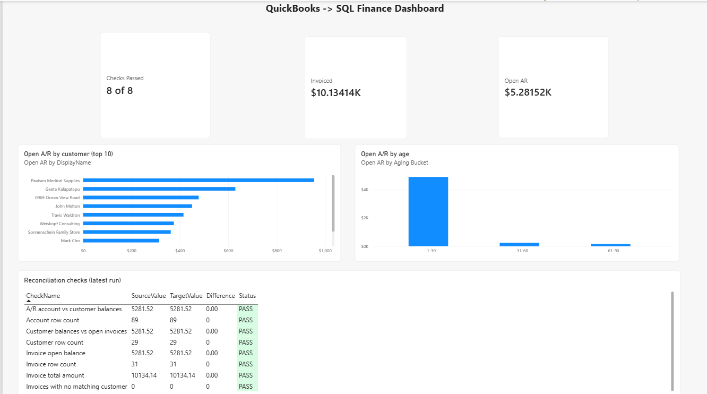

# quickbooks-finance-dashboard

Pulls customers, invoices and the chart of accounts from the QuickBooks Online API, loads them into SQL Server, proves nothing was lost or changed with reconciliation checks, and reports it in Power BI.



## How it works

| Step | File | What it does |
|---|---|---|
| 1. Extract | `extract.py` | Calls the QuickBooks Online API (sandbox) and saves each entity as JSON in `data/` |
| 2. Load | `sql/create_tables.sql`, `load.py` | Creates the `FinanceDemo` tables and loads Customer, Invoice and Account |
| 3. Reconcile | `reconcile.py` | Compares source (JSON) with target (SQL), checks that the ledger ties out, and saves every run to `dbo.ReconResults` |
| 4. Report | `powerbi/FinanceDemo.pbix` | One-page dashboard: totals, A/R by customer, A/R aging, latest reconciliation results |

## Reconciliation findings

- QuickBooks sandbox vs SQL: 29 customers, 31 invoices, 89 accounts. All counts match.
- Invoiced $10,134.14; open A/R $5,281.52. Invoices, customer balances and the A/R ledger account all agree.
- No invoices without a matching customer.
- **Break test:** added $100 to one invoice in SQL. "Invoice open balance" and "Customer balances vs open invoices" flagged EXCEPTION (−$100.00). Reloading restored all 8 PASS.
- Every run is saved to `dbo.ReconResults`, so the dashboard always shows the latest result.

## Run it

```bash
export QBO_REALM_ID=...        # sandbox company ID
export QBO_ACCESS_TOKEN=...    # from the OAuth 2.0 Playground (expires after about an hour)
python extract.py Customer && python extract.py Invoice && python extract.py Account
export SQL_SERVER='localhost\MSSQLSERVER01'
python load.py
python reconcile.py
```

Then open `powerbi/FinanceDemo.pbix` and click **Refresh**.
